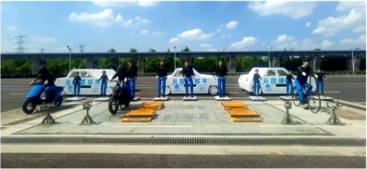
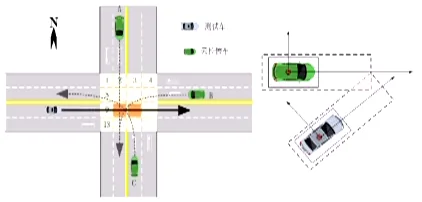

同济大学的云控多交通参与者测评系统，通过可控的模拟车辆、行人等目标，在封闭场地连续生成复杂交互场景。它希望提高长尾场景测试的效率，并把评价对象从单次避碰扩展到连续驾驶过程。

<!--more-->

## 为什么一次刹停测试还不够

自动驾驶需要应对的不只是识别目标，还包括安全、可靠、舒适、效率以及与其他交通参与者的协调。测试的任务，就是把这些需求落实为可以观察和评价的车辆行为。

自然驾驶测试面临“稀疏度灾难”：正常行驶数据很多，真正暴露系统边界的事件很少。路测中遇到危险时，驾驶者还可能提前接管，使完整的极端交互过程更难获得。单纯积累里程，难以高效覆盖这些长尾事件。

封闭场地可以重复测试，但一个固定速度、固定目标的刹停用例，只覆盖了有限条件。撞上目标说明该条件下有问题；没有撞上，也不能直接推出它在其他环境中同样可靠。还需要考察误制动、通行效率，以及与其他参与者交互时的表现。

以局部、固定工况为主的测试，存在五个方面的局限：

| 不足 | 对评价的影响 |
| --- | --- |
| 场景范围局部 | 难以考察被测车对更大范围交通运行的影响 |
| 环境条件简单 | 难以复现实际使用中的复杂情况 |
| 工况设置零散 | 难以覆盖完整的设计运行范围，即 ODD |
| 性能评价二元 | 单看“通过/失败”或“撞/不撞”，难以综合反映驾驶表现 |
| 功能测评分割 | 各项功能分别通过测试，不等于连续驾驶过程表现良好 |

因此，需要把测试从孤立事件推进到多参与者、连续动态的交互过程，并主动构造难以在自然路测中高效遇到的边缘场景。

## 系统的三个变化：混合、连续、主动

同济大学的方案利用 5G 云控和车路云协同，把模拟交通参与者组织起来，从参与者构成、场景连续性和冲突生成方式三个方面扩展测试能力：

| 问题 | 系统的变化 | 想解决的不足 |
| --- | --- | --- |
| 谁来参与测试？ | 从单一目标扩展到车辆、行人、两轮车等混合参与者 | 单一假人或假车难以代表复杂交通 |
| 场景怎样发生？ | 从一次事件扩展到连续动态场景 | 一次刹停结束后，观察不到后续驾驶行为 |
| 冲突从哪里来？ | 从等待预设事件触发，转向主动设计交互与冲突 | 稀有、高风险交互出现得太少 |

这里的主动冲突生成，是在封闭测试环境中安排模拟参与者的行为，使被测车更频繁地面对有挑战的交互。它和“多摆几个静止障碍物”有明显区别：场景会随参与者的运动而变化。

*模拟车辆、行人和两轮车等目标搭配移动底盘，共同构成可云控的交通参与者。*

## 一套系统、两类平台、三项关键技术

系统由云端数字孪生平台和模拟交通参与者平台共同支撑，分别负责场景组织与物理执行：

| 平台 | 组成与职责 |
| --- | --- |
| 云端数字孪生平台 | 以高精地图为基础，映射车、路、云信息，支持协议解析、多参与者群集调度、场景实时监测与管控 |
| 模拟交通参与者平台 | 使用移动底盘搭载假人、假车等目标，通过云控执行运动任务，把场景落实到物理测试场 |

模拟目标除了需要低成本和可重复使用，还要尽量保持对应交通参与者的物理成像、雷达散射等感知特征，并具有碰撞后的恢复能力。能移动只是第一步，被测车还需要把这些目标感知为对应的交通参与者。

两类平台之间，由三项技术串起测试过程：

1. **边缘场景学习生成**：决定要构造什么样的困难场景。
2. **多交通参与者协同轨迹滚动优化**：把场景要求转化成多个目标之间协调的运动轨迹。
3. **考虑不可靠通信的运动控制**：让物理平台在通信时延存在的情况下跟踪这些轨迹。

这三项技术分别处理场景、协同规划和运动执行，前后依赖，不能只靠其中某一项完成测试。

## 从场景生成到物理执行

### 边缘场景学习：让困难情况更容易出现

场景生成首先分析典型边缘场景，建立测试场景库，再利用 TD3 深度强化学习算法训练交互策略，生成公开道路上难以重复遇到的场景。

行为策略分为高层决策和较低层的运动控制：高层决定跟车、换道等行为，纵向控制和横向控制再把决策落实为运动。其中，横向控制采用双 PID，学习得到的决策与传统控制方法共同完成动作执行。

这一环节主要解决“测试什么”的问题：提高有限测试时间内困难场景的出现频率。

### 协同轨迹滚动优化：让多个参与者在时空上配合

有了目标场景，还需要让多个模拟参与者在合适的位置、合适的时刻与被测车交互。只有空间上接近，时间上没有重合，未必会形成预期冲突。

系统采用基于时空资源分配的主动冲突生成策略，以冲突时间窗口和空间可行域描述冲突风险，并用多车轨迹滚动优化应对时变干扰。路口交会就是一个典型例子：多辆车的到达时间和运动路径，共同决定了交互是否发生。

*左侧为路口中的多车运动关系，右侧为交会时的车辆相对位置。冲突生成需要同时协调车辆的到达时间与空间位置。*

“滚动”的含义是随着状态变化反复更新轨迹。它把上一步的场景意图转化为可持续调整的多参与者运动计划，而不只是一次性写死所有目标的路线。

### 运动控制：把通信时延纳入执行过程

通过 5G 下发任务，并不意味着控制链路没有时延。云端掌握的状态与车辆当前状态可能存在时间差，控制指令到达执行端也需要时间。

系统从时延建模、状态估计和跟踪控制三个环节处理这一问题：

- 对车—云端到端链路的通信时延建立概率模型，使用 Gamma 分布拟合时延特征。
- 通过修正卡尔曼滤波估计车辆状态，减轻信息延迟对状态判断的影响。
- 在车辆端执行跟踪控制：横向采用线性二次调节器，纵向采用抗积分饱和滑模控制。

时延模型描述信息到达的时间特征，状态估计器据此修正对车辆状态的判断，跟踪控制器再执行运动指令。三者配合，使通信时延成为控制设计中显式考虑的因素。

## 这个系统把测试推进到了哪一步

这套系统在封闭测试场中开展了连续动态城市 NOA 测试。场景生成提供交互要求，云端协调参与者运动，车端控制负责执行，数字孪生平台持续监测和管控测试过程，从而把困难场景的构造与物理测试衔接起来。

评价这样的测试系统，需要同时考察场景覆盖率、轨迹跟踪误差、重复测试一致性，以及相对于传统测试的加速倍数。提高困难场景的出现频率，还需要以场景的代表性和执行的可重复性为基础，才能帮助定位被测车辆的问题。

我觉得这个方案最值得关注的地方，是把“测一次会不会撞”扩展为“在连续交互中怎么开”。这也能与[自动驾驶的技术演进与挑战]()接起来：模型能够学会换道和避让之后，还需要用这样的测试去观察它在复杂交互中的表现。
