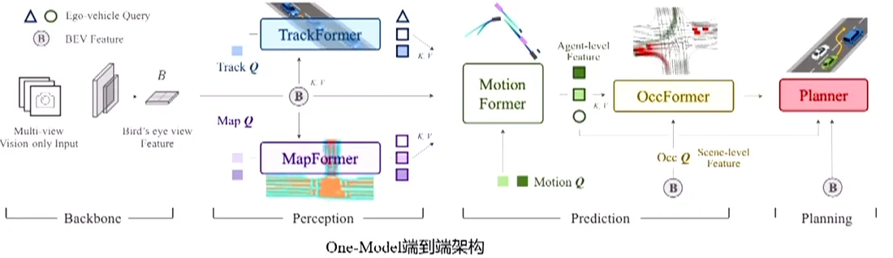
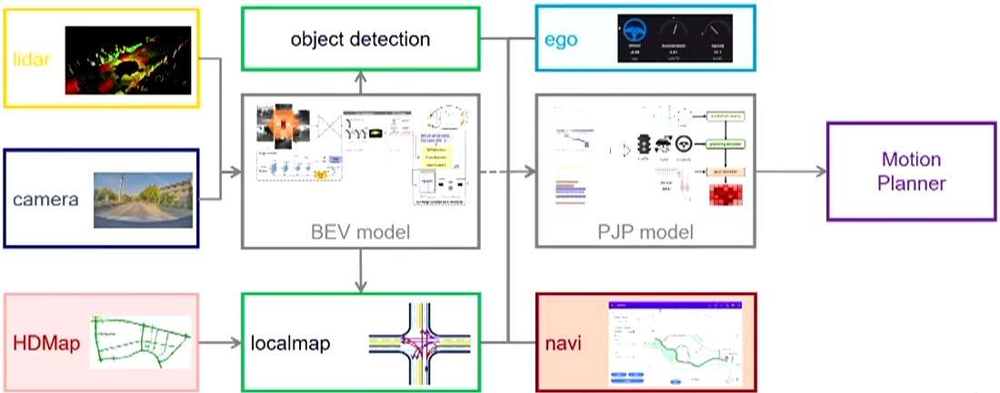

到 2024 年中，自动驾驶的数据驱动已经从感知逐渐扩展到预测和规划。从“看见道路上的目标”到“决定接下来怎么开”，模型需要处理更长的任务链条，也面临数据完整性、跨车型复用和训练算力等工程约束。

<!--more-->

## 从感知的数据驱动，到规划的数据驱动

自动驾驶可以先粗略理解为三个环节：感知负责观察周围环境，规划负责决定怎么走，控制负责把轨迹落实到车辆运动上。继续细分，还会涉及定位、跟踪、他车轨迹预测等模块。

按照学习方法覆盖的处理环节，这一演进可以分为三个阶段：

| 阶段 | 感知与预测 | 规划与控制 | 主要变化 |
| --- | --- | --- | --- |
| 以感知的数据驱动为主 | 用神经网络识别目标；融合、跟踪和轨迹预测仍较多依赖人工设计 | 规则逻辑、传统优化和控制方法 | 神经网络主要承担“看见什么” |
| 多阶段独立的数据驱动 | 引入 BEV、Transformer、占据表示，以及数据驱动的轨迹预测 | 规则规划结合采样、剪枝和神经网络加速 | 多个模块都使用学习方法，但仍分别组织 |
| 向端到端发展 | 感知特征与预测、规划之间更紧密地连接 | 尝试直接学习自车轨迹 | 学习目标向“接下来怎么开”延伸 |

BEV 指鸟瞰视角下的环境表示。随着环境表示能力和预测能力增强，**数据驱动逐渐覆盖更长的处理链条**，规划也开始更多地利用学习得到的特征。

### 特斯拉案例说明了什么

特斯拉 FSD 的演进体现了这种变化。在 V11 阶段，自动标注、仿真和数据引擎支撑感知网络的训练；网络输出占据信息、车道和目标等结果，规划部分仍较多依赖多层级采样与规则，神经网络用于辅助加速。

对于 V12，一种可能的架构是：多路相机经过特征提取和时空融合后，同时连接占据、车道和轨迹等不同解码器。这样，轨迹生成就有机会利用比显式目标列表更丰富的中间特征。这是对内部实现的推测。

仪表盘呈现的是便于人理解的目标和轨迹，模型内部还可能传递没有直接显示出来的特征。因此，仅凭仪表盘上的轨迹形态，很难判断系统怎样组织感知和规划。更值得关注的是：**下游规划拿到的，究竟只有感知结果，还是也包括中间特征？** 这直接影响了模型之间的信息传递方式。

## Two-Model：先把决策规划做成数据驱动

Two-Model 的一种实现方式，是把系统主要拆成感知模型和决策规划模型：

1. 感知模型处理传感器数据，形成目标、车道、局部地图等环境表示，也可以包含跟踪与预测任务。
2. 决策规划模型接收感知结果或 BEV 特征，结合导航和自车状态，预测其他交通参与者的运动，并生成自车目标轨迹。

一种开发思路是在已有轨迹预测模型上增加自车轨迹输出，用人类驾驶数据学习“在这样的交通环境里应该怎么走”。关键变化发生在决策规划部分：它需要从规则体系转向数据驱动体系。

决策规划模型需要综合环境、行驶意图和自车状态，输入输出包括：

| 决策规划模型的信息 | 具体内容 |
| --- | --- |
| 其他交通参与者 | 历史轨迹，以及上游提供的感知结果或特征 |
| 道路环境 | 一定范围内的地图、车道与路口红绿灯信息 |
| 行驶意图 | 导航信息 |
| 自车状态 | 自车运动状态等信息 |
| 模型输出 | 他车的短时、长时预测轨迹，以及自车目标运动轨迹 |

这一拆分可以复用已有感知能力，但也把一个问题带到了规划模型面前：输入信息是否完整，跨版本、跨车型时是否仍然一致？

## 两个直接影响训练的数据问题

### 数据完整性：采到了行驶轨迹，不等于采齐了决策依据

同一车型的不同配置可能具有不同的传感器覆盖范围。缺少侧向、后向观测时，虽然能记录自车怎么开，却未必能还原驾驶者当时面对的完整交通环境。这类数据不一定满足决策规划模型的训练需求。

导航意图也不容易补齐。辅助驾驶启用时可能直接记录导航路线；人工驾驶时，如果没有同步记录导航，就只能尝试从后续轨迹反推。仅有二三十秒的行驶片段，有时还不足以确定驾驶者准备去哪里。

所以，数据规模不能只按车辆数或行驶里程来衡量，还要看每段数据是否包含训练所需的信息。

### 数据复用性：模型和车型变了，旧数据还能不能直接用

第一类变化来自上游感知。漏检、误检会进入规划模型的输入；感知模型升级后，目标、车道、实时地图和红绿灯等输出的分布也可能改变。旧版本输出上训练出的规划模型，不能默认对新版本仍然适用。使用高精地图能减少部分地图信息对在线感知结果的依赖，但不等于消除了全部输入变化。

第二类变化来自车辆本身。不同轴距、质量和驱动形式的车辆，对相同转向或加减速输入的响应不同。把不同车型的数据放在一起训练，需要处理自车状态和运动响应的差异。

这两类问题分别对应“看见的世界变了”和“执行动作的车变了”。

## One-Model：减少中间接口，也提高了训练门槛

One-Model 尝试把从传感器输入到自车轨迹输出的过程放到统一模型中。任务之间可以传递更丰富的特征，减少只传递显式感知结果所造成的信息瓶颈。与此同时，更长的处理链条也需要共同训练和验证。

*One-Model 内部的特征传递：从 BEV 表示经过感知、预测到达规划，各任务模块共同构成统一模型。*

两条路线在工程上有以下取舍：

| 比较项 | One-Model | Two-Model |
| --- | --- | --- |
| 训练与算力 | 训练难度和算力需求更高 | 相对容易利用已有模块推进 |
| 数据记录与传输 | 需要保留较完整的原始观测，数据量较大 | 可以记录结构化结果，数据量较小 |
| 感知误差的影响 | 减少对显式感知接口的依赖 | 更直接受到漏检、误检以及上游版本变化的影响 |
| 导航与自车信息 | 同样需要处理导航缺失和车型差异 | 同样需要处理导航缺失和车型差异 |
| 地图与红绿灯 | 可利用原始观测中的相关信息 | 较依赖上游显式结果的准确性 |

在训练资源有限、已有感知模型可以复用的条件下，先推进 Two-Model 是一种现实选择。One-Model 则需要为更完整的数据记录和更复杂的联合训练投入更多资源。两条路线都绕不开数据质量问题。

端到端模型上车后，规则校验仍然有价值：模型生成轨迹后，可以再检查约束是否满足。保留可检查的中间结果，有助于分析问题；系统的安全性还需要通过具体场景中的测试来验证。

## 上汽的实践：感知模型与预测决策模型协作

上汽在 2024 年的 L3/L4 端到端实践中采用了 Two-Model 架构。激光雷达和相机接入 BEV 模型，形成目标检测和局部地图等信息；局部地图还可以结合高精地图。预测决策模型 PJP 接收感知信息、自车状态和导航等输入，再连接后续的运动规划模块。

*上汽 Two-Model 架构：BEV 模型提供环境表示，PJP 模型结合自车和导航信息完成预测决策，并与运动规划模块衔接。*

道路演示覆盖了常规行车、主动换道和路口避让三类场景，交互需求逐步增加：

| 演示场景 | 车辆表现 | 涉及的驾驶能力 |
| --- | --- | --- |
| 常规行车 | 数据量较多、场景相对简单，模型较容易得到稳定效果 | 在常见场景下保持稳定行驶 |
| 前方有静止或慢速车辆 | 模型可以作出主动换道决策 | 从保持行驶扩展到改善通行效率 |
| 路口交互 | 模型表现出较灵活的横向避让 | 根据其他交通参与者的运动调整路线 |

这些行为展示了数据驱动规划的潜力。要进一步判断它们能否稳定复现，还需要在不同交通密度、道路条件和交互方式下开展重复测试，并考察成功率和失效条件。

对我来说，这部分最有意思的是：数据驱动方法有机会从驾驶数据中学到换道、避让等行为。但“能在演示里做出来”之后，还需要回答“在什么条件下能稳定做出来”。这也接到了另一篇笔记讨论的[多交通参与者测试与评价]()。
